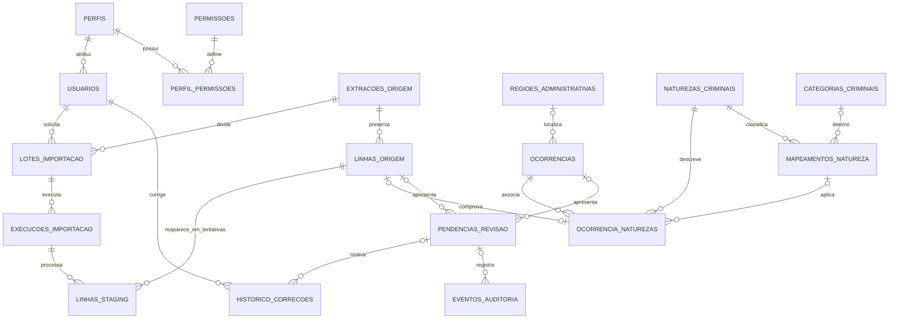

# Modelagem PostgreSQL/PostGIS — v1.0

Data: 29/10/2026 (America/Sao_Paulo). Escopo: Sprint 4, Etapa 1. Status: baseline aplicada e regressão aprovada localmente em PostgreSQL 17.11/PostGIS 3.6.2; ver [relatório de execução](execucao-local-sprint4-etapa1-2026-10-29.md). Esta etapa prepara persistência, sem implementá-la nas telas ou habilitar acesso de usuários.

Referências obrigatórias: [contrato PCDF](../contratos/importacao-pcdf-v1.0.md) e [Central de Revisão](../funcionalidades/central-revisao-ocorrencias-v1.0.md). Complementos: [deduplicação/permissões](../contratos/deduplicacao-permissoes-v0.1.0.md), [API v0.1.0](../contratos/api-v0.1.0.md), [catálogo demonstrativo](../contratos/catalogos-v0.1.0.json), `src/contracts/{common,occurrences,imports,analytics,adapters,openapi}.ts` e `src/data/demoPermissions.ts`.

As decisões PCDF/Central prevalecem sobre trechos históricos de `docs/arquitetura.md` que bloqueavam toda ocorrência sem coordenadas ou previam correção de localização pelo Operador. Registro pode ser consolidável sem localização; correções na Central são exclusivas do Administrador. Nenhuma geocodificação automática é implementada nesta baseline.

## 1. Artefatos e estratégia

Arquivos executáveis em [database/migrations](../../database/migrations):

| Migration | Responsabilidade |
| --- | --- |
| `0001_base_catalogos.sql` | PostGIS, schema privado `sentinela`, ledger, perfis/permissões, usuários sem senhas, catálogos, mapeamento e RA. |
| `0002_origem_importacoes.sql` | Extração XML, lote CSV mensal, tentativas/checkpoints, linhas originais e staging por execução. |
| `0003_ocorrencias_revisao.sql` | Ocorrências, associações, vínculos de consolidação, pendências, correções e auditoria. |
| `0004_integridade_protecao.sql` | Triggers de integridade/imutabilidade, avaliação territorial e RLS fechado. |
| `0005_integridade_revisao_seguranca.sql` | Correção incremental: identidade protegida, vínculos de revisão, autoria histórica, auditoria na transação e trava explícita até Auth/backend reais. |

Não existia padrão de migrations SQL no repositório; adotada numeração sequencial independente do frontend e do CLI Supabase. Aplicação manual, limites, pré-requisitos, testes e versionamento estão no [roteiro local](../../database/README.md). As migrations não leem XML/CSV nem criam uma política de ingestão automática.

## 2. Entidades e justificativas

| Tabela | Papel e principais relações |
| --- | --- |
| `schema_migrations` | Ledger de versões aplicadas; separado dos lotes de negócio. |
| `perfis` | Somente Administrador, Operador e Analista. Não são roles LOGIN PostgreSQL. |
| `permissoes` | Capacidades da aplicação, sem abrir acesso SQL. |
| `perfil_permissoes` | Matriz N:N, com correção na Central apenas para Administrador. |
| `usuarios` | Perfil ativo e UUID opcional de identidade externa; futura associação Supabase Auth. Sem senhas/tokens. |
| `categorias_criminais` | Categorias principais versionadas; suporta as 20 previstas, sem seed de códigos/nomes ou limite artificial de cardinalidade. |
| `naturezas_criminais` | Descrição específica e categoria PCDF textual preservadas por fonte; suporta as 41 descrições e 19 categorias sem reduzi-las ao catálogo demonstrativo. |
| `mapeamentos_natureza` | Regra versionada por natureza e tentativa para categoria principal; só homologação permite categoria atribuída. |
| `regioes_administrativas` | RA/catalogação versionada, vigência e limite cartográfico opcional com evidência de referência espacial. |
| `extracoes_origem` | Identidade do XML imutável, hash, nome/tamanho, referência privada, metodologia e manifesto. Justifica distinguir fonte de cada CSV mensal. |
| `lotes_importacao` | Arquivo CSV identificado por hash e extração, versão, competência, quantidade esperada e solicitante. Metadados imutáveis. |
| `execucoes_importacao` | Tentativa, status, versões, contagens, checkpoint e falha. Necessária para reprocessar sem reescrever o lote. |
| `linhas_origem` | Uma posição lógica SpreadsheetML por extração/aba, 18 valores textuais originais e metadados estruturais. Imutável. |
| `linhas_staging` | Snapshot CSV por execução e linha de origem; derivados corrigíveis, diagnósticos e vínculos opcionais à ocorrência/associação. |
| `ocorrencias` | ID interno, identidade candidata/homologada, data/hora civil, RA/endereço, estado de consolidação e localização. Não exige preenchimento fictício de campos históricos. |
| `ocorrencia_naturezas` | Relação 1:N da ocorrência para associações; tentativa por associação, mapeamento opcional e linha de origem única. |
| `pendencias_revisao` | Ocorrência e/ou linha de origem, regra/campo, prioridade, efeito, situação, revisor e justificativa. Várias simultâneas. |
| `historico_correcoes` | Correção de ocorrência, associação ou staging, com antes/depois, Administrador, instante, justificativa, versão e resultado da reavaliação. |
| `eventos_auditoria` | Eventos humanos/serviço, inclusive detecção, reabertura, reenvio e decisões; separado das correções de campo. |

As tabelas adicionais de extração, execução, mapeamento, autorização e eventos evitam confundir granularidades, sobrescrever proveniência ou misturar evento automático com correção humana. Não há tabela de bairro, geocodificação ou catálogo oficial inventado.

## 3. Relações

O diagrama resume relações; o SQL contém os demais vínculos, incluindo três destinos exclusivos do histórico e a FK composta staging → associação/origem/ocorrência. Uma pendência deve ter ocorrência ou linha, podendo ter ambas mediante associação comprovando o mesmo par; uma correção deve ter exatamente um destino: ocorrência, staging ou associação.

## 4. Identidade e multiplicidade

**369.660** mede associações de origem. **349.582** mede combinações distintas informadas para Ano de Registro + Unidade Policial de Registro + Número; continua candidato não homologado. A diferença não é contabilizada como duplicação.

Os três componentes são texto, sem remoção de zeros, sinais ou espaços. O namespace da fonte e a versão da identidade são explícitos. O índice candidato **não é único**: a existência de chave igual não executa merge nem comprova identidade. Só o estado `homologada`, com evidência e componentes completos, ativa unicidade por fonte/versão/tupla. A alteração de versão da identidade não deve ser usada para contornar a unicidade: sua migração/reconciliação exige procedimento próprio ainda pendente.

Consolidação futura deve bloquear casos de chave ausente ou conflito em staging e usar transações/serialização da chave candidata para evitar criação concorrente de ocorrências órfãs. O banco não escolhe qual ocorrência representa um conflito. Não existe trigger para promover uma linha a ocorrência.

Cada linha XML tem UUID interno, identificador externo estável, extração, aba e posição lógica. Unicidade `(extracao_id, aba_origem, linha_xml)` impede duas identidades para a mesma posição. O backend futuro verifica que o ID externo foi produzido pelo algoritmo versionado correto; a constraint não comprova criptograficamente o algoritmo nem a fidelidade dos bytes.

`ocorrencia_naturezas.linha_origem_id` é único para associações importadas: repetir a mesma linha em outra tentativa não cria associação nova. Duas linhas de origem distintas com a mesma natureza podem produzir duas associações, sem unicidade cega por ocorrência/categoria. `crime_tentado` é booleano anulável **da associação**, preservando o texto recebido em `linhas_origem`.

Campos originais de tentativa e flagrante continuam texto; booleanos efetivos são separados. Catálogos e mapeamentos são imutáveis nesta baseline: homologações/revisões são inseridas como novas versões, sem alterar classificações passadas. Não há seed das 41 descrições ou das 20 categorias: será tarefa controlada após conferência, não carga disfarçada nesta etapa.

## 5. Localização e pertencimento

Os quatro campos de coordenadas originais ficam em `linhas_origem` como texto, sem SRID. Não há transformação de UTM, inferência de datum/zona/eixos ou coordenada sintética.

`ocorrencias.geometria` é **geometry(Point,4326) de destino**, não declaração de que o dado PCDF é WGS84. Pode ficar nula. Para preenchê-la são exigidos par numérico válido, estado `validada`, evidência da referência espacial e regra de transformação, além da concordância exata X=longitude/Y=latitude. Essa evidência textual ainda precisa de verificação humana/serviço: preencher uma string não comprova homologação. Não há trigger que crie geometria automaticamente.

Usa-se `geometry` em coordenadas geográficas, não uma segunda coluna `geography`; evita duas fontes da verdade. Cálculos métricos futuros devem usar transformação/cast apropriados após validação, sem medir graus como metros. Latitude/longitude numéricas rejeitam domínio inválido, infinito e NaN; coordenadas inválidas originais permanecem no bruto e geram diagnóstico.

A função `sentinela.avaliar_pertencimento_territorial(uuid)` devolve `pendente`, `vigencia_incompativel`, `compativel` ou `divergente`, sem alterar registros. Limites nulos, ponto nulo ou data ausente impedem uma conclusão. Usa a vigência da RA e `ST_Covers`, incluindo a borda; limites devem ser válidos e ter referência/cartografia documentadas. RA divergente não move o ponto nem é corrigida automaticamente. A função avalia apenas a RA escolhida, não procura uma RA por proximidade.

Cartografia histórica, aliases, tratamento de sobreposições, escolha de versão territorial e correspondência com `RA 98_NÃO INFORMADA` continuam pendentes. Uma RA só entra com código interno documentado; não carregar RA-S/Ponte Alta como RA oficial. Não impor limite numérico de 34 RAs, 41 descrições ou 20 categorias como constraint permanente.

Diferença espacial relevante: `ST_SetSRID` apenas marca referência; `ST_Transform` transforma coordenadas. Essa distinção fundamenta a ausência de transformação automática. Referências primárias: [ST_SetSRID](https://postgis.net/docs/ST_SetSRID.html), [ST_Transform](https://postgis.net/docs/ST_Transform.html) e [ST_Covers](https://postgis.net/docs/ST_Covers.html).

## 6. Importações, checkpoint e reprocessamento

O lote representa um CSV mensal UTF-8 com `;`, contrato candidato de 34 colunas e competência no primeiro dia do mês. Não fixa o intervalo histórico como limite permanente do banco; a cobertura 2021-01 a 2026-08 é conferida no manifesto da carga. `campos_csv` preserva o snapshot, e os 18 campos originais têm colunas próprias imutáveis. A validação dos 34 cabeçalhos/tipos e o vínculo fiel XML/CSV ainda pertencem ao importador futuro; JSONB ser objeto não prova layout correto.

Proveniência composta exige que execução/lote/linha pertençam à mesma extração. Cada execução tem ordinal CSV único e não pode repetir a mesma linha de origem. A FK composta impede staging apontar para associação de outra linha ou de outra ocorrência.

O hash é hexadecimal SHA-256 em minúsculas, com validação lexical no banco. O futuro backend deve calcular/conferir os bytes: uma constraint não verifica o arquivo no Storage. Unicidade extração/hash do CSV bloqueia reenvio do mesmo conteúdo sob outro nome/versão no mesmo XML. Arquivos diferentes da mesma competência podem existir para diagnóstico/revisão; seus overlaps precisam ser verificados pelas identidades de origem, sem exclusão automática.

Tentativas são separadas do lote. Índice parcial permite no máximo uma tentativa ativa por lote; tentativa > 1 exige motivo. Estados de execução: criada, validando, aguardando confirmação, processando, concluída, falhou ou cancelada. Trata-se do vocabulário inicial, não de uma máquina completa de transições autorizadas. Nova tentativa usa os mesmos IDs de origem/associação, nunca recria dados para justificar versão nova.

Checkpoint é ordinal de registro CSV, não byte offset ou linha textual; campos multilinha tornam a diferença essencial. A implementação deve registrar checkpoint e bloco consolidado na **mesma transação**. Se houver paralelismo, checkpoint representa o prefixo contínuo confirmado, não o maior registro concluído isoladamente. `checkpoint_detalhes` admite metadados, mas não implementa fila, lease ou retomada.

Contagens da execução são por unidade:

- `linhas_processadas = linhas_aptas + linhas_bloqueadas + linhas_reenviadas`, sem interseção dessas parcelas.
- `linhas_lidas` pode superar processadas durante trabalho; execução concluída exige igualdade. Reconciliar também com `linhas_esperadas` e staging no serviço futuro.
- `ocorrencias_criadas` e `associacoes_criadas` são incrementos desta tentativa, não totais históricos do banco. Reenvios idempotentes não os aumentam.
- `pendencias_detectadas` e `erros_detectados` podem superar linhas: várias causas por registro. Não somá-los como parcelas de processamento.

Os contadores ainda não são calculados automaticamente por triggers e não provam reconciliação. O backend deve conferir manifesto, staging e projeções antes de concluir. A baseline não impõe 369.660/349.582 como resultado artificial.

Reimportação idêntica é barrada por hashes/identidades. Sobreposição em **nova extração XML** não pode ser reconhecida com segurança sem chave oficial/política de atualização; manter no staging, comparar e revisar antes de consolidar. Não afirmar que a baseline já resolve deduplicação institucional entre extrações. Registrar tentativas rejeitadas como eventos; o conflito UNIQUE sozinho não cria auditoria.

## 7. Central de Revisão, correções e auditoria

Pendência pode pertencer a ocorrência ou linha original ainda não consolidada. Campo/regra/versão e origem identificam diagnóstico de forma única, incluindo NULLs, evitando duplicá-lo a cada reavaliação. Reabrir o mesmo diagnóstico mantém ID e histórico; nova regra pode produzir novo diagnóstico versionado.

Prioridade (`alta/media/baixa`) é independente de efeito (`nao_bloqueante/bloqueia_dimensao/bloqueia_consolidacao`). Faltas opcionais podem permanecer não bloqueantes. Situação usa aberta, em análise, resolvida ou encerrada sem solução; encerramento exige data, justificativa e revisor. O trigger exige Administrador ativo para novas atribuições, preservando a autoria histórica sem revalidá-la em cada UPDATE. A autorização do autor real depende de Auth/backend; até lá, a migration 0005 bloqueia correções, decisões manuais e autoria humana de auditoria, inclusive quando o cliente informa UUID de Administrador.

`valor_original` da pendência, campos originais e snapshots são protegidos contra alteração. `historico_correcoes` é append-only e registra responsável, data, antes/depois, motivo, versão anterior e resultado da reavaliação. Ações de detecção, reabertura, fechamento sem solução, reenvio e segurança cabem em `eventos_auditoria`, com ator humano ou serviço distinguido.

Versão incremental e timestamp são atualizados por trigger em ocorrência, associação, staging e pendência. A API futura deve usar `UPDATE ... WHERE id = ... AND versao = ...`, conferir uma linha afetada e gravar correção/evento/reavaliação na mesma transação. Depois de 0005, triggers diferidos conferem histórico correspondente por alvo, campo, versão anterior, valores e transação para UPDATE de ocorrência/associação/staging; mudanças de pendência exigem evento com os snapshots completos antes/depois. Essa defesa não autentica o autor nem implementa reavaliação semântica. Escrita permanece bloqueada até o caminho autorizado e transacional ser implementado.

Fechar sem solução não preenche o dado, não muda automaticamente a consolidação nem remove bloqueios. A correspondência entre alvo da correção e pendência é verificada estruturalmente em 0005. Reavaliação automática, precedência dos diagnósticos, transições e política de reabertura exigem serviço transacional futuro; sua presença em tabelas não implementa o fluxo.

## 8. Segurança e preparação Supabase Auth

Todas as 19 tabelas recebem **ENABLE e FORCE RLS**, sem policies de liberação; schema/tabelas/sequências/funções revogam acesso de PUBLIC. A aplicação continua sem leitura/escrita persistente nesta etapa. Não são criados roles `anon`, `authenticated`, `service_role`, schema `auth` falso ou funções que confiem em GUC/localStorage para identidade.

`usuarios.auth_user_id` é UUID único opcional, sem FK `auth.users` ainda. Na integração posterior: vincular identidade verificada à tabela real de Auth, homologar regra de desativação/remoção sem perder autoria e implementar escopos. Não armazenar senha, token ou chave de serviço. Perfil não é metadado editável pelo próprio usuário.

Matriz planejada:

| Operação | Administrador | Operador | Analista |
| --- | --- | --- | --- |
| Consultar análises e Central | Conforme escopo | Conforme escopo | Conforme escopo |
| Cadastro/importação | Conforme escopo | Conforme escopo | Negado |
| Correção/resolução pela Central | Permitido com justificativa/auditoria | Negado | Negado |
| Administrar usuários/catálogos | Por operação confiável auditada | Negado | Negado |
| Reescrever originais/auditoria | Negado | Negado | Negado |

Futuras policies SELECT/INSERT/UPDATE devem combinar identidade ativa, capacidade e escopo, com `USING`/`WITH CHECK` e autoria derivada no servidor. Como o escopo institucional não está homologado, nenhuma política provisória `USING(true)` foi criada. Leitura da Central para Analista não equivale a acesso irrestrito ao XML ou histórico sensível; usar projeção minimizada e autorizada.

As funções são invoker e têm search_path fixado. Não há SECURITY DEFINER exposto. A avaliação territorial também respeita o contexto de leitura do chamador. Revogações de default privileges valem para o criador das migrations; futuras roles criadoras precisam repetir a configuração. Validar schema de extensão e grants na migração Supabase, sem copiar cegamente a baseline local.

Superusuários/BYPASSRLS ignoram RLS e o dono pode alterar triggers/DDL; essas identidades não são usuários da aplicação. Imutabilidade por trigger não é proteção contra administrador do servidor. RLS não controla TRUNCATE; há triggers explícitos de bloqueio e nenhum grant correspondente. Referência primária: [PostgreSQL — Row Security Policies](https://www.postgresql.org/docs/15/ddl-rowsecurity.html).

## 9. Preservação, desempenho e limites

Extratos, lotes, linhas originais, catálogos versionados, correções, eventos e ledger rejeitam UPDATE/DELETE por trigger; todas as tabelas rejeitam TRUNCATE. As FKs não usam cascata destrutiva. Reter dados e reverter decisões deve preservar relações históricas; descarte legal exige procedimento separado, ainda não homologado. Não inserir conteúdo sensível desnecessário em logs comuns ou manifesto público.

XML/CSV são referenciados por local privado, não armazenados como cópias grandes em cada linha. As 18 strings originais e o snapshot CSV aumentam volume deliberadamente pela rastreabilidade. `estrutura_celulas` permite preservar presença/tipo/posição da célula; não substituir o XML como prova lexical. Backup/restauração deve cobrir banco e arquivos privados e comparar hashes; não foi executado ensaio de restauração.

Índices B-tree cobrem períodos, RA/período, natureza/ocorrência, lote, estado, origem e histórico; GiST cobre pontos e limites territoriais. Após 0005 são 38 índices explícitos, além de PK/UNIQUE, incluindo apoio à auditoria por alvo/versão/transação. São ponto inicial, não resultado de benchmark. Verificar `EXPLAIN (ANALYZE, BUFFERS)` com carga representativa antes de acrescentar GIN ao JSONB, particionamento ou materializações. Não particionar automaticamente por cada um dos 68 CSVs: arquivo mensal é organização de entrada, não prova de necessidade de particionamento físico.

## 9.1. Proteções incrementais de 0005

As quatro migrations anteriores foram preservadas. O conjunto corrigido tem **19 tabelas, 34 FKs e 38 índices explícitos**. Não houve alteração dos 34 campos CSV ou dos contratos PCDF/Central, carga de dados, seed criminal ou migração de ambiente.

- Identidade/proveniência da ocorrência, inclusive fonte, componentes da chave, versão, estado/evidência de identidade e ID, não podem ser alterados por UPDATE comum. Transferir associação para outra ocorrência também é bloqueado. Reidentificação/promoção da chave exige procedimento específico futuro, auditado e reversível; não promover silenciosamente a candidata a oficial.
- Staging definitivo exige ocorrência e associação juntas, com a FK composta já existente. Antes disso, candidatos de correspondência ficam nos diagnósticos/derivados, sem afirmar vínculo canônico. Uma pendência pode continuar ligada somente à origem enquanto não houver associação confiável; vincular simultaneamente ocorrência e origem exige `associacao_id` comprovando a mesma tripla. A origem da pendência não é reescrita após sua criação.
- A correção resolve seu alvo por ocorrência, associação ou staging e confere correspondência com a pendência. Eventos que informam alvos adicionais também precisam corresponder ao mesmo caso/linha/extração. Referências incompatíveis de históricos anteriores fazem a migration falhar, preservando os dados para diagnóstico.
- Novas inserções de histórico/eventos recebem `transacao_id` e instante do próprio banco; valores enviados pelo cliente são substituídos. Históricos anteriores mantêm transação desconhecida como NULL; constraints NOT VALID exigem a informação somente nas novas linhas, sem retroatribuir a transação da migration ao passado.
- A conferência diferida exige, para cada campo alterado de ocorrência/associação/staging, histórico com nome físico do campo SQL, valores JSON antes/depois (incluindo JSON null), versão anterior e mesma transação. Em pendências, o evento deve conter snapshots completos da transição. Um registro genérico de histórico ou de outra versão/transação não basta.
- A reavaliação técnica pode preservar responsável histórico inativo/reclassificado. Nova atribuição exige Administrador ativo. Isso não autoriza o revisor antigo a realizar uma nova ação: autorização do ator é independente da autoria preservada.
- A trava por statement rejeita UPDATE/DELETE dessas quatro tabelas e INSERT de correções. Outra trava rejeita inserção de pendência já atribuída/decidida e autoria humana em eventos. Não há bypass por UUID, GUC, conta Administrador do catálogo ou função de aplicação. Mesmo operações técnicas que precisem desses UPDATEs aguardam um backend confiável; isso não concede ao Operador correção pela Central nem transforma serviço em Administrador.
- Para liberar fluxos reais, uma migration futura deve substituir a trava por identidade verificada do Auth, escopo e operação autorizada, mantendo a auditoria e a reavaliação atômicas. Não basta remover triggers ou conceder UPDATE direto. Histórico estrutural é defesa adicional, não prova de que a justificativa é verdadeira ou de que a validação semântica foi executada.

Testes locais de regressão isolam fixtures com DDL transacional de superusuário e reabilitam as proteções para verificar sua rejeição. A aplicação não recebe poder de ALTER TABLE. As constraints diferidas são forçadas antes do ROLLBACK. Nesta entrega, só foram analisadas sintaxe/estrutura: não há evidência de execução PostgreSQL/PostGIS, concorrência ou homologação.

Carregar em blocos transacionais com índices de identidade ativos, parametrização e limites de memória; usar staging e reconciliação antes das projeções. Não desabilitar constraints/RLS para acelerar a aplicação. Consultas devem paginar no servidor e limitar recorte geográfico; não enviar 369.660 associações ou toda a referência de calor a cada navegação.

Indicadores: ocorrências por IDs distintos; associações de origem por IDs de associação/linha; distribuição categorial por pares distintos ocorrência/categoria quando essa for a unidade homologada. A soma de naturezas pode superar ocorrências. Bases novas e históricas só compartilham cobertura após reconciliação.

## 10. Compatibilidade e pendências antes da Etapa 2

O SQL é modelo de armazenamento, não substituto silencioso do contrato público. Os schemas Zod/OpenAPI v0.1.0 continuam inalterados: horário HH:mm, oito naturezas demonstrativas, coordenadas WGS84 e envelopes previstos precisam de evolução/adaptação para os dados históricos. SQL usa UUID interno, hora com segundos, campos históricos anuláveis e múltiplas associações; o frontend não foi conectado.

Revisar com a equipe:

1. Chave oficial PCDF, conflitos e política entre extrações; aprovar como a candidata será promovida e como evitar concorrência na consolidação.
2. Mapeamento integral das 41 descrições/19 categorias para as 20 previstas, códigos internos, tentativa e evidências; aprovar carga controlada de catálogo.
3. CRS/datum/zona/eixos e transformação, cartografia histórica/RA e tratamento de divergências; validar escolha do destino 4326 sem atribuí-lo ao original.
4. Convenções definitivas dos 34 campos/manifesto, nulos, segundos, identidade de linha e snapshot estrutural; confirmar algoritmo SHA-256 com SENTINELA-DADOS.
5. Permissões por escopo, vínculo Supabase Auth, policies restritivas e caminho administrativo auditado; não liberar grants antes disso.
6. Máquina de estados de lote/revisão, reavaliação automática, checkpoints, locks, contagens finais e tratamento de falhas parciais.
7. Retenção, reversão, histórico temporal dos catálogos/RA, auditoria e backup dos arquivos privados.
8. Aplicar a baseline em PostgreSQL/PostGIS local descartável e executar regressão real, incluindo concorrência e rollback. A análise estática realizada não dispensa essa verificação.

Sequência sugerida: revisar esta modelagem → provisionar/validar banco local → fechar contratos operacionais e identidade de Auth → implementar RLS e operações auditadas → upload/staging/validação → Central → consolidação idempotente → APIs e integração das telas → ensaio reconciliado dos 68 arquivos. Não há autorização implícita para conectar ou migrar ambiente remoto.
