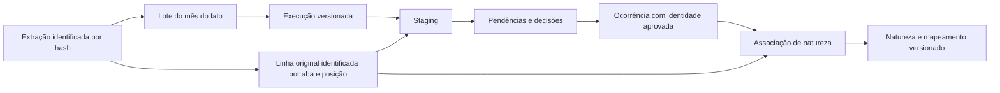

# Proposta de integração futura da PCDF

## Evidência de origem e escopo

Consulta documental de 19/11/2026. Foram lidos o relatório de recebimento
e o código de `visualizar_xml_pcdf.py` do repositório SENTINELA-DADOS. O
script percorre linhas SpreadsheetML com `iterparse`, respeita `ss:Index`,
contabiliza tipos e valores, protege a abertura das amostras em planilhas
e produz relatório, CSV e XLSX de inspeção. Esses artefatos de inspeção
servem de referência para um pipeline mensal a ser implementado e validado.

O relatório registra 369.660 associações, 18 campos originais,
41 naturezas originais e 19 valores de Natureza Padronizada PCDF.
O contrato prevê 20 categorias SENTINELA mediante aprovação de
correspondências. A chave candidata agrupa por ano de registro, unidade
de registro e número textual. A linha de origem tem uma identidade
independente. [Contrato PCDF v1.0](../contratos/importacao-pcdf-v1.0.md)

## Integração proposta

O inventário extraído dos catálogos PostgreSQL documenta tipos,
nulabilidade e chaves das tabelas da baseline e da escrita sintética.
[Dicionário PostgreSQL](dicionario-postgresql-homologacao.md)

| Área | Modelo e regra |
| --- | --- |
| Extração | `extracoes_origem` identifica a fonte e registra hash, versão e metadados. Conservar XML e metodologia imutáveis em armazenamento privado. A extração nova recebe identidade própria. |
| Lotes e execuções | `lotes_importacao` separa a competência da data de ingestão. `execucoes_importacao` registra tentativas, resultados, contagens, erros e status. Propor manifesto por mês do fato com hash do XML e CSV, versões e reconciliação. |
| Origem e staging | `linhas_origem` guarda a associação original identificada por hash, aba e posição lógica. `linhas_staging` liga origem, lote e execução, preservando diagnóstico de campo, payload e resolução posterior. |
| Identidade principal | `ocorrencias` recebe uma ocorrência por identidade aprovada. Registro candidato incompleto ou divergente vai para revisão. Manter zeros e grafia de números e unidades. |
| Associações | `ocorrencia_naturezas` vincula ocorrência, linha de origem e natureza, com tentativa e status de classificação. Total geral conta a ocorrência uma vez. Distribuição por natureza conta conforme o contrato de analytics. |
| Mapeamento | `naturezas_criminais`, `categorias_criminais` e `mapeamentos_natureza` separam origem, categoria de destino e versão da correspondência. Preservar desconhecidos e pendentes. |
| Geografia | `regioes_administrativas` fornece UUID e referência cartográfica. Preservar valores GEO/UTM originais e registrar CRS, ordem dos eixos, regra de transformação e versão. Geometria permanece ausente até validação espacial. |
| Revisão e auditoria | `pendencias_revisao` aponta para origem, staging ou ocorrência. `historico_correcoes` e `eventos_auditoria` registram campo, antes/depois, versão, ator e transação conforme o vínculo exigido. |

## Processamento e aceite

1. Qualificar o transporte UTF-8 com delimitador `;` e a ordem exata
   das 34 colunas. Validar a composição **18 originais + 10 derivados +
   6 técnicos**. Buscar interpretação de fórmulas, espaços, sinais e
   zeros exclusivamente na representação original e nas regras aprovadas.
2. Gerar o manifesto por competência do fato. Guardar diagnóstico por
   linha/campo. Os registros com data insuficiente para determinar a
   competência entram na quarentena de tratamento e na reconciliação.
3. Registrar novos bytes por hash e serializar execuções concorrentes
   por lote. O reenvio do mesmo artefato retorna o recibo anterior. Novas
   regras de classificação ou correção exigem reprocessamento versionado
   com linhagem explícita para o artefato anterior.
4. Separar duplicidade de transporte, coincidência de identidade
   candidata e coexistência de várias naturezas. Preservar colisões
   entre extrações e impedir promoção automática de grupos divergentes.
5. Promover em transação após análise das pendências. Reconciliar linhas
   lidas, quarentena, associações promovidas e ocorrências distintas.
   Repetir com falhas e reenvio para testar rollback e idempotência.

Decisões do produtor pendentes incluem identidade entre extrações,
aliases de unidades, matriz criminal e vocabulário de flagrante e tentativa,
referência GEO/UTM e eixos, vigência do vínculo territorial, regras por
tipo de pendência e reabertura após consolidação. A leitura técnica
respeitou o escopo documental, com o XML e o repositório de dados preservados.
